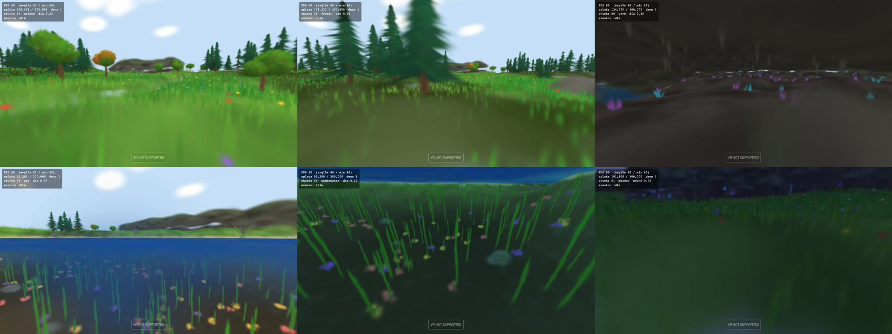

# Cloud Gaussian Worlds (PoC) — Claude (Opus 5.5)

> Part of the [GaussianWorlds benchmark](../README.md). This version was generated by **Claude (Opus 5.5)** in **1 implementation iteration** (**0 subagents**; direct tools only) from a single consolidated prompt containing 3 spec blocks (matching Gemini's iterations 1–3), with no Quest 3 feedback or follow-up fixes.  
> **Live Demo:** https://cachemarra.github.io/GaussianWorlds/opus-5.5/

An infinite procedural world made solely of **Gaussian Splats** (**Three.js `0.180`** + **Spark `2.4.0`** via CDN, zero build step).  
Features four biomes (meadow, conifer forest, cave, and diveable sea), rivers/lakes/wells in meadow & forest, wind animation, day/night cycle, procedural piano/flute music, day/night ambience, and the nocturnal peripheral figure event.



## Serving Locally

Desktop (`localhost` does not require HTTPS):

```bash
npx serve -l 5173 .
```

Open `http://localhost:5173`.

### Running on Meta Quest 3 (WebXR requires HTTPS or `localhost`)

1. **GitHub Pages (wireless, automatic HTTPS)**: Open `https://cachemarra.github.io/GaussianWorlds/opus-5.5/` in Quest Browser and press **ENTER VR**.
2. **USB + `adb reverse`** (fastest locally): Enable Developer Mode on Quest, connect over USB, and run:
   ```bash
   adb reverse tcp:5173 tcp:5173
   ```
   Open `http://localhost:5173` in Quest Browser and press **ENTER VR**.

### URL Parameters

Configure runtime parameters directly via query string:

```text
?budget=200000&radius=2&seed=7&day=120
```

- `budget`: Splat budget
- `radius`: Chunk ring radius
- `seed`: World seed
- `day`: Seconds per full day/night cycle

## Controls

| Action | Desktop | Quest 3 |
| :--- | :--- | :--- |
| Look | Mouse (click for pointer lock) | Head tracking |
| Move | `WASD` (`Shift` to sprint) | Left stick |
| Turn | Mouse | Right stick (30° snap turn) |
| Jump / swim up | `Space` | `A` |
| Dive down | `C` | `B` |
| Day ↔ Night | `N` | `X` |
| Trigger night event (debug) | `F` | `Y` |
| Teleport to biome | `1` Meadow · `2` Forest · `3` Cave · `4` Sea | — |
| Toggle HUD | `H` | — |

The HUD displays FPS (current, average, and 10s minimum), loaded splats vs. budget, density, and event state. In VR it renders as a floating panel attached to the view. The console also logs `[stats] {...}` every 10 seconds.

## What Was Verified (Headless Chromium on macOS Desktop)

- Meadow, forest, cave, sea, and underwater diving render with zero console errors (~90k–125k splats across 49–61 chunks).
- Wind animation verified: grass displaces between frames.
- Day-to-night transition verified: sky, stars, moon, and color tinting.
- Night event verified: footsteps play, figure spawns at 25–40 m and ~50° off-axis; looking at it triggers a "pop" and disappearance; ignoring it causes it to fade after 10 s; never spawns on the same side twice in a row.
- Audio was verified at the code level only (cannot be audited acoustically in headless Chromium).

**Pending headset validation:** Real Quest 3 FPS, snap-turn/locomotion comfort, figure legibility in VR, VR HUD legibility, spatial HRTF audio, and `A/B/X/Y` button mapping.

## Known Risks

- Every animated splat (wind and waves across the 9 nearest chunks) is regenerated on the GPU every frame — the main performance cost on Quest.
- Day/night tinting regenerates static chunks in staggered batches (every 20 frames); entering a cave or water takes ~1/3 s to propagate color changes to distant chunks.
- Initial chunk generation runs on the main thread (1 chunk per frame), which can cause brief frame hitches.
- Collisions are heightfield-only: trees and rocks can be walked through; cave walls block only where ceiling height drops below 1.9 m.
- At 30–40 m, the ~2 m tall figure is small and may be hard to spot against dark trees in Quest.

## First 3 Performance Tweaks for Quest 3

1. **Lower budget and chunk radius**: `?budget=150000&radius=2`.
2. **More aggressive LOD**: In `js/config.js`, set `LOD_DENSITY: [0.6, 0.2, 0.06]` and restrict wind animation to `c.lod === 0` (current chunk only in `World.animate`).
3. **Reduce fill-rate**: Lower `renderer.xr.setFramebufferScaleFactor(0.8)` before entering VR and tighten `maxStdDev` on `SparkRenderer` (already set to √5 on Quest).

## Automated Headless Test (Desktop)

`test/headless.cjs` launches headless Chromium via Playwright, visits all biomes, switches to night, and triggers the night event twice (once observed, once ignored), saving captures into `test/shots/`. Start the local server first:

```bash
npm i -D playwright && npx playwright install chromium && node test/headless.cjs
```
